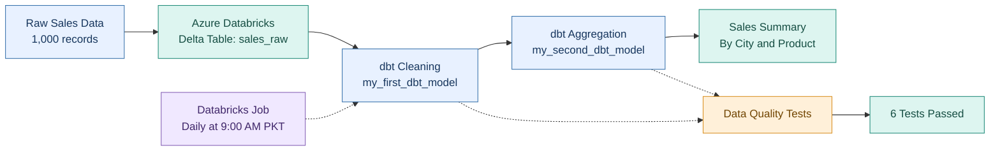

# Sales Data Engineering Pipeline

## Project Overview
This project demonstrates a sales data pipeline built with Azure Databricks, Delta Lake, dbt, SQL, and GitHub. It transforms raw sales data into clean datasets and generates revenue summaries by city and product.

## Tech Stack
- Azure Databricks
- Delta Lake
- dbt Core and dbt-databricks
- SQL
- Git and GitHub
- Databricks Jobs & Workflows

## Pipeline Architecture



## Dataset
The raw dataset contains 1,000 sales records with these columns:
- `order_id`
- `city`
- `product`
- `price`
- `quantity`
- `order_date`

## Transformations

### 1. Clean Sales Data
The `my_first_dbt_model` model:
- Converts price, quantity, and order date to suitable data types.
- Calculates `total_sales` as price multiplied by quantity.
- Filters out records with missing order IDs, non-positive prices, or non-positive quantities.

### 2. Sales Summary
The `my_second_dbt_model` model groups sales by city and product and calculates:
- Total orders
- Total quantity sold
- Total revenue

## Data Quality
Configured dbt tests check:
- Unique and non-null order IDs
- Non-null city values
- Non-null product values

**Local validation:** All 6 configured dbt tests passed.

## Automation
A Databricks Job runs these commands:

```bash
dbt deps
dbt run
dbt test
```

The job ran successfully and is configured for a daily schedule at 9:00 AM Pakistan time.

## Project Structure

```text
sales_dbt/
├── analyses/
├── macros/
├── models/
│   └── example/
│       ├── my_first_dbt_model.sql
│       ├── my_second_dbt_model.sql
│       └── schema.yml
├── seeds/
├── snapshots/
├── tests/
├── dbt_project.yml
└── README.md
```

## Run Locally
1. Configure Azure Databricks and the required SQL warehouse.
2. Prepare the `sales_raw` Delta table.
3. Install dbt Core and the Databricks adapter.
4. Configure your dbt profile and authentication securely.
5. Run:

```bash
dbt debug
dbt deps
dbt run
dbt test
```

Never commit access tokens, passwords, or other secrets to GitHub.

## GitHub Repository
https://github.com/abdullahtouseef/sales-data-pipeline

## Learning Outcomes
- SQL-based data transformation using dbt
- Working with Delta tables
- Data quality testing
- Git and GitHub version control
- Workflow automation using Databricks

**Author:** Abdullah Tauseef
